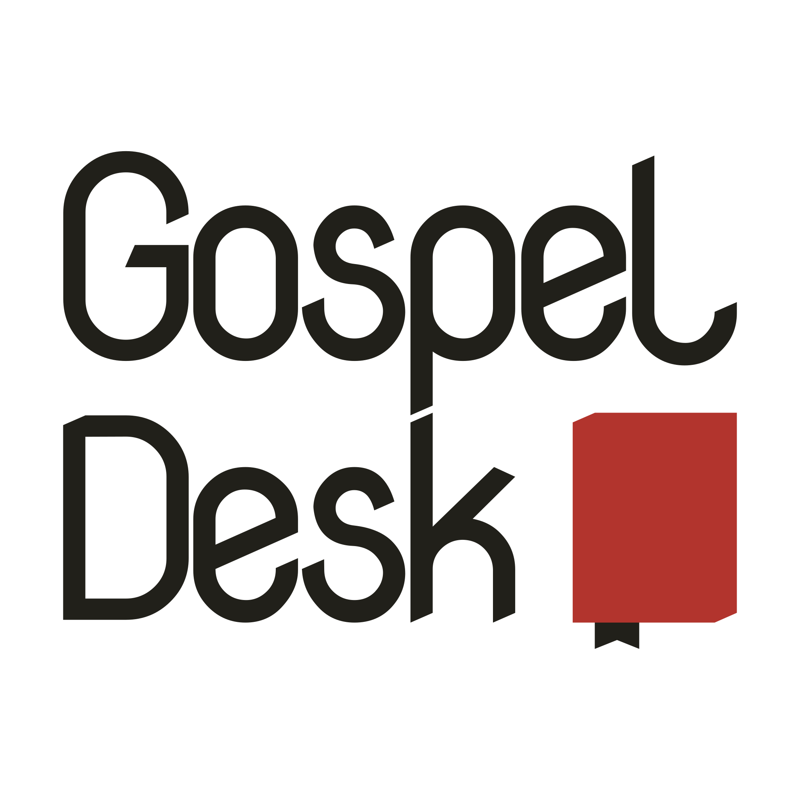
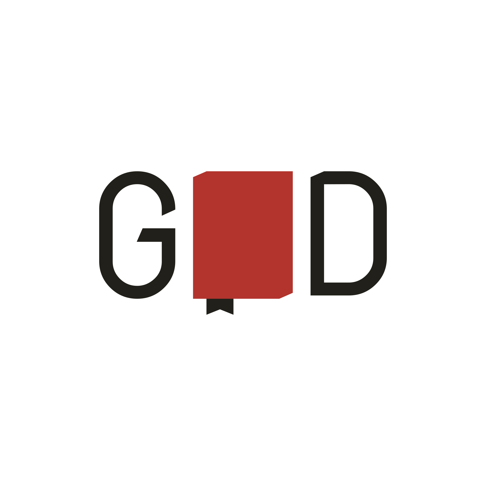

Greetings! Thanks for visiting! My name is Chad Whitacre. I am a member of <a
href="https://orthodoxpittsburgh.org">St. Nicholas Orthodox Church</a> (OCA)
outside of Pittsburgh.  I publish this website with the blessing of His
Eminence, Archbishop Melchisidek of Pittsburgh and Western Pennsylvania. Glory
to God for all things!&nbsp;✚

### Contact

  Best to <a href="https://www.orthodoxpittsburgh.org/parishcalendar">find me
  in person</a>, second-best is <a
  href="mailto:chad@zetaweb.com">email</a>.

### Logos and Colors

  
  
  

  
#FAF6F2

  
#21201A

  
#B2342D

